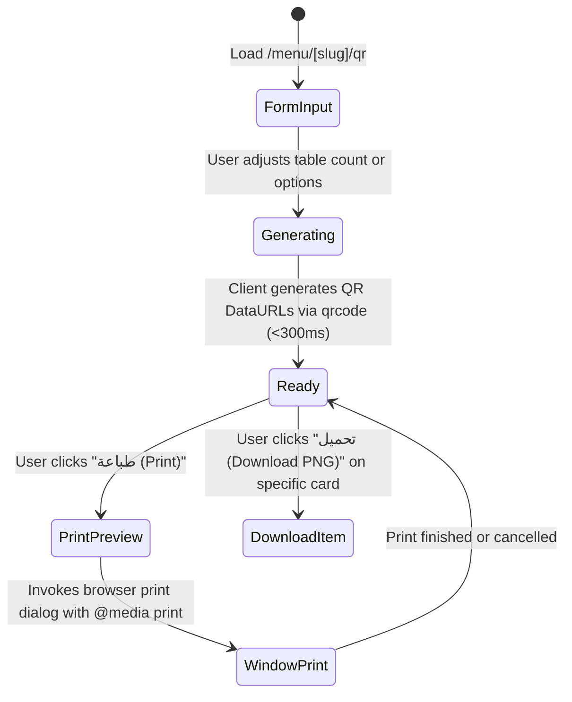

# Data Model: QR Code Table Generator & Printable Cards

**Feature**: `003-qr-table-generator`  
**Date**: 2026-11-08  
**Status**: Completed  

---

## 1. Entities & Type Definitions

### 1.1 `TableQRCard`
Represents an individual generated QR card item (either a specific table or a storefront code).

```typescript
export interface TableQRCard {
  id: string; // e.g. "table-1", "storefront"
  tableNumber?: string | number; // e.g. 1, 2, "VIP-1", or undefined for storefront
  targetUrl: string; // e.g. "http://localhost:3000/menu/oriental-grill?table=1"
  qrDataUrl: string; // Base64 PNG data URL generated by `qrcode`
  title: string; // e.g. "طاولة رقم 1" / "Table #1" or "كود الطلب المباشر"
  subtitle?: string; // e.g. "امسح الكود لطلب الطعام"
}
```

### 1.2 `QRGeneratorConfig`
State managed by the generator form controls:

```typescript
export type QRMode = 'tables' | 'storefront';

export interface QRGeneratorConfig {
  mode: QRMode;
  tableCount: number; // 1 to 100 (default: 10 for restaurants/cafes, 1 for storefront)
  startNumber: number; // default: 1
  tablePrefix: string; // optional prefix, e.g. "" or "T-"
  showLogo: boolean; // default: true
  showWifi: boolean; // default: false
  wifiSsid: string; // e.g. "GrillHouse_Guest"
  wifiPassword: string; // e.g. "welcome2026"
  customInstructionAr: string;
  customInstructionEn: string;
}
```

### 1.3 `QRValidationSchema` (Zod Schema)
Enforces runtime constraints in accordance with Constitution Principle I & III:

```typescript
import { z } from 'zod';

export const qrGeneratorConfigSchema = z.object({
  mode: z.enum(['tables', 'storefront']),
  tableCount: z.number().int().min(1, 'Table count must be at least 1').max(100, 'Table count cannot exceed 100'),
  startNumber: z.number().int().min(1, 'Start number must be positive').default(1),
  tablePrefix: z.string().max(10).optional().default(''),
  showLogo: z.boolean().default(true),
  showWifi: z.boolean().default(false),
  wifiSsid: z.string().max(50).optional().default(''),
  wifiPassword: z.string().max(50).optional().default(''),
  customInstructionAr: z.string().max(120).optional().default(''),
  customInstructionEn: z.string().max(120).optional().default(''),
});
```

---

## 2. State Lifecycle & Transitions



---

## 3. Relationships to Existing Entities

1. **Store Model (`Store` in `src/types/store.ts`)**:
   - `slug`: Encoded in the QR destination URL (`/menu/${store.slug}`).
   - `businessType`: If `supermarket`, generator defaults `mode: 'storefront'` and disables table count inputs.
   - `name_ar` / `name_en`: Displayed at the header of each printable tent card.
   - `logo_url`: Rendered atop the QR card when `showLogo === true`.

2. **Cart Context (`src/features/cart/hooks/use-cart.tsx`)**:
   - `tableNumber`: Pre-populated when customer arrives at `/menu/[slug]?table=[number]`.
   - `orderType`: Automatically set to `dine_in` when table parameter is present.
