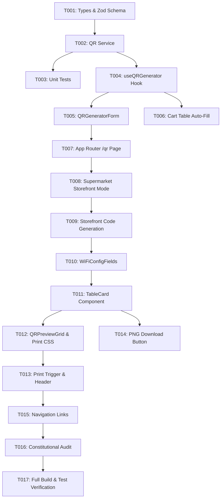

# Tasks: QR Code Table Generator & Printable Cards

**Input**: Design documents from `/specs/003-qr-table-generator/`  
**Prerequisites**: `plan.md`, `spec.md`, `research.md`, `data-model.md`, `contracts/qr-service.ts`

## Format: `[ID] [P?] [Story] Description`

- **[P]**: Can run in parallel (different files, no dependencies)
- **[Story]**: User story identifier ([US1], [US2], [US3], [US4])
- Strict adherence to Constitution v2.2.0: max 180 lines per file, zero native dialogs, logical CSS properties only (`ms-`, `me-`, `ps-`, `pe-`, `text-start`, `text-end`).

---

## Phase 1: Setup & Types (Foundational)

**Purpose**: Core data types, validation schemas, and service contracts

- [X] T001 [P] Define QR generator types (`TableQRCard`, `QRGeneratorConfig`, `QRMode`) and Zod schema in `src/features/qr/types.ts`
- [X] T002 Implement core client-side QR service (`generateQRDataUrl`, `generateQRCards`, `downloadQRImage`) using `qrcode` in `src/features/qr/services/qr-service.ts`
- [X] T003 [P] Create unit tests for QR service (`generateQRDataUrl`, table URL encoding, storefront URL encoding) in `tests/unit/qr-service.test.ts`

**Checkpoint**: Foundation ready - QR generation engine and types verified by unit tests.

---

## Phase 2: User Story 1 - Batch Table QR Code Generation (Priority: P1) 🎯 MVP

**Goal**: Merchants can generate 1 to 100 table QR codes with URL `${origin}/menu/[slug]?table=N`, and scanning automatically pre-fills the table in the customer cart.

**Independent Test**: Navigate to `/menu/oriental-grill/qr`, enter 5 tables, verify 5 QR codes are generated with URLs `.../menu/oriental-grill?table=1` to `table=5`. Open `.../menu/oriental-grill?table=3` and verify cart auto-selects `dine_in` and table `3`.

- [X] T004 [P] [US1] Create custom hook `useQRGenerator` managing config state, debounced batch generation, and download handlers in `src/features/qr/hooks/use-qr-generator.ts`
- [X] T005 [P] [US1] Create `QRGeneratorForm` component for table count (1 to 100), start number, table prefix, and logo toggle in `src/features/qr/components/qr-generator-form.tsx`
- [X] T006 [US1] Update `src/app/menu/[slug]/page.tsx` and cart initialization to read `?table=N` searchParam and automatically set `tableNumber` and `orderType: "dine_in"`
- [X] T007 [US1] Create thin App Router page `src/app/menu/[slug]/qr/page.tsx` resolving store slug and rendering `QRGeneratorScreen`

**Checkpoint**: User Story 1 MVP fully operational: batch QR generation and table scan integration work end-to-end.

---

## Phase 3: User Story 2 - Storefront / Retail QR Mode for Supermarkets & Takeaway (Priority: P1)

**Goal**: Supermarkets and delivery/takeaway businesses (e.g., `fresh-market`) generate storefront QR codes linking to `/menu/[slug]` without table parameters.

**Independent Test**: Navigate to `/menu/fresh-market/qr`, verify system automatically defaults to Storefront mode with delivery scan instructions and table inputs hidden.

- [X] T008 [US2] Update `QRGeneratorForm` to adapt mode based on `store.businessType` (auto-select `storefront` for supermarkets) and support mode switching tabs in `src/features/qr/components/qr-generator-form.tsx`
- [X] T009 [US2] Update `useQRGenerator` to generate single storefront code encoding `${origin}/menu/${storeSlug}` with promotional delivery CTA when `mode === 'storefront'` in `src/features/qr/hooks/use-qr-generator.ts`

**Checkpoint**: User Stories 1 & 2 operational: restaurants generate table batches; supermarkets generate storefront delivery codes.

---

## Phase 4: User Story 3 - Elegant Print-Ready Table Stand Cards (Priority: P1)

**Goal**: Format QR codes into professional, printable tent cards with store logo, table badge, CTA, and optional WiFi credentials.

**Independent Test**: Preview cards in browser; verify tent card layout contains brand logo, table badge, clean QR code, and bilingual labels. Toggle WiFi and verify SSID/password display.

- [X] T010 [P] [US3] Create subcomponent `WiFiConfigFields` for WiFi SSID and password toggles and inputs in `src/features/qr/components/wifi-config-fields.tsx`
- [X] T011 [US3] Create `TableCard` component rendering printable tent card with store branding, table number badge, high-contrast QR image, scan CTA, and WiFi block in `src/features/qr/components/table-card.tsx`
- [X] T012 [US3] Create `QRPreviewGrid` component with responsive screen layout and print-optimized `@media print` styling (2 cards per A4 page, pure white background, page-break-inside avoid) in `src/features/qr/components/qr-preview-grid.tsx`

**Checkpoint**: User Story 3 operational: cards render beautifully on screen and fit 2-per-page on A4 print preview.

---

## Phase 5: User Story 4 - One-Click Print & High-Res Image Downloads (Priority: P2)

**Goal**: Provide a primary "Print All Cards" action triggering native print dialog without UI clutter, and individual PNG download buttons on each card.

**Independent Test**: Click "Print All Cards" -> verify print preview opens cleanly without header/form clutter; click "Download PNG" on Card #1 -> verify `oriental-grill-table-1.png` is downloaded.

- [X] T013 [US4] Add "Print All Cards" action header button and print-only store header in `src/features/qr/components/qr-generator-screen.tsx`
- [X] T014 [US4] Add individual PNG download button to `TableCard` component with accessible 44×44px touch target in `src/features/qr/components/table-card.tsx`

**Checkpoint**: User Story 4 operational: full print pipeline and PNG export verified.

---

## Phase 6: Polish, Integration & Cross-Cutting Concerns

**Purpose**: Navigation links, accessibility, line limit audit, test suite pass, and build verification.

- [X] T015 [P] Add quick navigation link/button to `/menu/[slug]/qr` in `src/features/menu/components/restaurant-header.tsx` and home portal `src/app/page.tsx`
- [X] T016 Audit all new files in `src/features/qr/` to guarantee <= 180 lines per file, zero native dialogs, and 100% logical CSS properties
- [X] T017 Run full validation suite: `npm run type-check`, `npm run lint`, `npm test`, and `npm run build`

---

## Dependencies & Execution Order

---

## Parallel Execution Examples

- **Phase 1**: T001 (types) and T003 (unit test scaffold) can run alongside T002 (service).
- **Phase 2 & 4**: T005 (`QRGeneratorForm`) and T010 (`WiFiConfigFields`) can be built in parallel.
- **Phase 5 & 6**: T014 (`TableCard` download button) and T015 (navigation links) can be executed in parallel.
