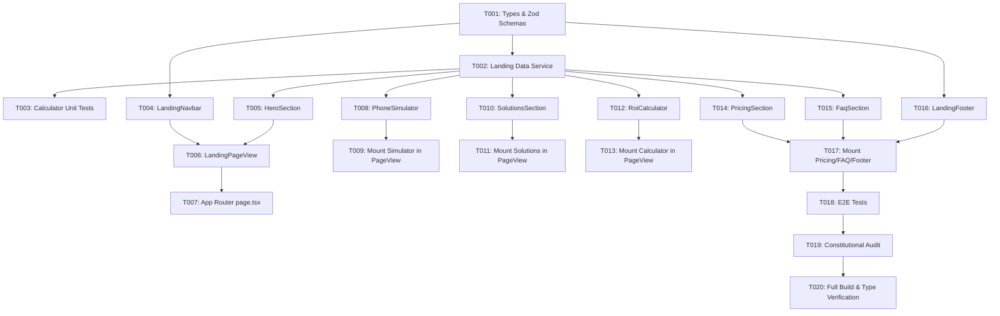

# Tasks: Marketing Landing Page & Platform Portal

**Input**: Design documents from `/specs/004-marketing-landing-page/`  
**Prerequisites**: `plan.md`, `spec.md`, `research.md`, `data-model.md`, `contracts/landing-contracts.ts`

## Format: `[ID] [P?] [Story] Description`

- **[P]**: Can run in parallel (different files, no dependencies)
- **[Story]**: User story identifier ([US1], [US2], [US3], [US4], [US5])
- Strict adherence to Constitution v2.2.0: max 180 lines per file, zero native dialogs, logical CSS properties only (`ms-`, `me-`, `ps-`, `pe-`, `text-start`, `text-end`).

---

## Phase 1: Setup & Foundational

**Purpose**: Core data types, mock platform content, ROI calculation engine, and unit tests

- [ ] T001 [P] Define landing page TypeScript types (`PricingPlan`, `FaqItem`, `BusinessSolution`, `CalculatorState`) and Zod schemas in `src/features/landing/types.ts`
- [ ] T002 [P] Implement landing data service (`getPricingPlans`, `getFaqItems`, `getBusinessSolutions`, `calculateSavings`, `buildWhatsAppInquiryUrl`) in `src/features/landing/services/landing-data.ts`
- [ ] T003 [P] Create unit tests for savings calculator formulas and turnover metrics in `tests/unit/roi-calculator.test.ts`

**Checkpoint**: Core data structures and financial formulas verified by unit tests.

---

## Phase 2: User Story 1 - High-Impact Hero & Live Pilot Models Showcase (Priority: P1) 🎯 MVP

**Goal**: Transform the root route `/` into a high-converting hero with bilingual RTL/LTR support, clear value proposition, and interactive pilot model demo links.

**Independent Test**: Navigate to `/`, verify hero headline, value badges (0% commission, instant WhatsApp orders), language toggle, and 3 distinct pilot cards linking to `/menu/oriental-grill`, `/menu/specialty-cafe`, and `/menu/fresh-market`.

- [ ] T004 [P] [US1] Create `LandingNavbar` component with brand logo, in-place language toggle, and direct WhatsApp contact action in `src/features/landing/components/landing-navbar.tsx`
- [ ] T005 [P] [US1] Create `HeroSection` component with headline, value proposition badges, primary trial CTA, and pilot demo cards in `src/features/landing/components/hero-section.tsx`
- [ ] T006 [US1] Create `LandingPageView` root container assembling sections in `src/features/landing/components/landing-page-view.tsx`
- [ ] T007 [US1] Update `src/app/page.tsx` as a clean route delegating to `LandingPageView`

**Checkpoint**: User Story 1 MVP fully operational: visiting `/` renders the high-impact hero and pilot demo links in Arabic and English.

---

## Phase 3: User Story 2 - Interactive Live Mobile Phone Simulator (Priority: P1)

**Goal**: Embed an interactive CSS smartphone simulator on the landing page letting visitors experience menu browsing and live reactive cart updates without leaving the page.

**Independent Test**: In the phone simulator on `/`, switch between Restaurant, Café, and Supermarket tabs, tap (+) on sample items, and verify the floating cart bar reacts live with total EGP price inside the mockup.

- [ ] T008 [US2] Create `PhoneSimulator` component with responsive smartphone frame, vertical business tabs, interactive product cards, and reactive floating cart bar in `src/features/landing/components/phone-simulator.tsx`
- [ ] T009 [US2] Integrate `PhoneSimulator` into `LandingPageView` alongside the hero section in `src/features/landing/components/landing-page-view.tsx`

**Checkpoint**: User Story 2 operational: merchants can test-drive the digital menu live inside the smartphone simulator.

---

## Phase 4: User Story 3 - Tailored Business Solutions Grid (Priority: P2)

**Goal**: Showcase tailored feature cards demonstrating how the platform addresses specific operational needs of Restaurants, Cafés, and Supermarkets.

**Independent Test**: Scroll to Solutions section; verify 3 distinct feature cards with customized highlights for restaurants (dine-in & grills), cafés (cup sizes & pastries), and supermarkets (kg/liter units & grocery delivery).

- [ ] T010 [P] [US3] Create `SolutionsSection` component rendering tailored cards with icons, bulleted highlights, and direct demo links in `src/features/landing/components/solutions-section.tsx`
- [ ] T011 [US3] Mount `SolutionsSection` inside `LandingPageView` in `src/features/landing/components/landing-page-view.tsx`

**Checkpoint**: User Story 3 operational: vertical-specific value propositions clearly displayed.

---

## Phase 5: User Story 4 - Interactive Commission Savings & ROI Calculator (Priority: P2)

**Goal**: Provide a real-time reactive calculator showing restaurant owners their monthly and annual savings compared to 15%-25% aggregator cuts.

**Independent Test**: Adjust orders slider to 500 and average order to 200 EGP; verify calculator outputs 18,000 EGP/month and 216,000 EGP/year saved with WhatsApp CTA button.

- [ ] T012 [P] [US4] Create `RoiCalculator` component with monthly orders slider, average basket slider, live savings counters in EGP, and WhatsApp CTA in `src/features/landing/components/roi-calculator.tsx`
- [ ] T013 [US4] Mount `RoiCalculator` inside `LandingPageView` in `src/features/landing/components/landing-page-view.tsx`

**Checkpoint**: User Story 4 operational: real-time financial ROI calculator proven.

---

## Phase 6: User Story 5 - Transparent Pricing & WhatsApp Onboarding CTA (Priority: P3)

**Goal**: Present 3 transparent subscription plans (Starter, Pro, Enterprise), an accessible FAQ accordion, and footer with direct WhatsApp onboarding links.

**Independent Test**: Click "اشترك الآن" on any pricing card or "احجز نسختك" in FAQ; verify WhatsApp opens with pre-filled Arabic/English message targeting sales.

- [ ] T014 [P] [US5] Create `PricingSection` component displaying 3 subscription tier cards with feature lists, monthly prices, and WhatsApp deep links in `src/features/landing/components/pricing-section.tsx`
- [ ] T015 [P] [US5] Create `FaqSection` component with interactive accessible accordion answering key merchant questions in `src/features/landing/components/faq-section.tsx`
- [ ] T016 [P] [US5] Create `LandingFooter` component with copyright, brand summary, and quick links in `src/features/landing/components/landing-footer.tsx`
- [ ] T017 [US5] Mount Pricing, FAQ, and Footer components in `LandingPageView` in `src/features/landing/components/landing-page-view.tsx`

**Checkpoint**: User Story 5 operational: complete conversion funnel ready for production.

---

## Phase 7: Polish, Integration & Verification

**Purpose**: Responsive checks, line-limit audit, E2E test suite, and production build verification.

- [ ] T018 [P] Create end-to-end test suite covering landing page render, language toggle, and simulator interactions in `tests/e2e/landing-page.spec.ts`
- [ ] T019 Audit all components in `src/features/landing/` to guarantee <= 180 lines per file, zero native dialogs, and 100% logical directional CSS
- [ ] T020 Run full validation suite: `npm run type-check`, `npm run lint`, `npm test`, and `npm run build`

---

## Dependencies & Execution Order

---

## Parallel Execution Opportunities

- **Phase 1**: T001 (types), T002 (service), and T003 (unit tests) can be built in parallel.
- **Phase 2 & 3**: T004 (`LandingNavbar`), T005 (`HeroSection`), and T008 (`PhoneSimulator`) can be developed simultaneously.
- **Phase 4 & 5**: T010 (`SolutionsSection`) and T012 (`RoiCalculator`) have zero cross-dependencies.
- **Phase 6**: T014 (`PricingSection`), T015 (`FaqSection`), and T016 (`LandingFooter`) can be created in parallel.
